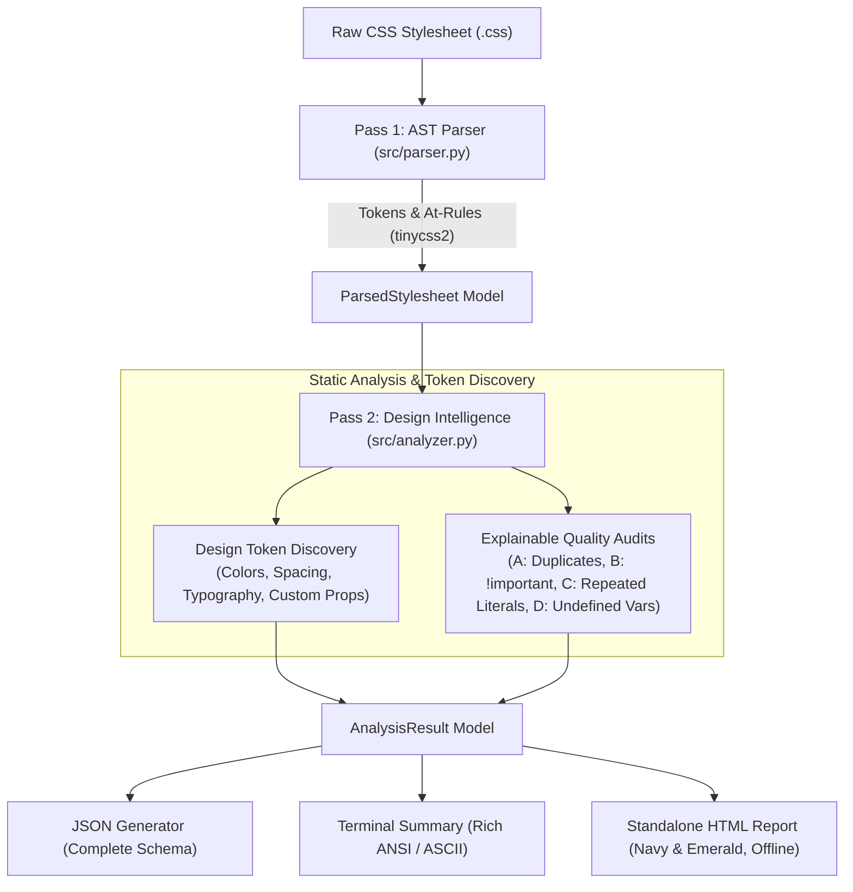

# CSS INSIGHT ENGINE
> **From Raw Stylesheets to Explainable Design Intelligence**  
> *Skill First Labs — AI/ML Internship Shortlisting Assignment (Milestone 1)*

[](https://www.python.org/downloads/)
[](https://github.com/Kozea/tinycss2)
[](https://docs.pytest.org/)
[](LICENSE)

---

## 1. Problem Statement & Philosophy

The assignment prompt asks for:
> *"A parser that reads a CSS file and pulls out meaningful, structured information from it — not just the raw text. Keep it simple. Along with your code, write 3–4 lines explaining what you chose to extract and why, and one edge case you thought about."*

Most basic submissions will implement a regex-based string parser or dump raw AST dictionaries into JSON. **CSS Insight Engine** takes a compiler-inspired static analysis approach:

1. **True AST Parsing, Not Regex:** CSS grammar cannot be parsed reliably with regular expressions. We use `tinycss2` to build a faithful AST that respects CSS Syntax Module Level 3.
2. **Design System Intelligence:** Rather than treating CSS as flat strings, the engine discovers design tokens (color palettes, spacing scales, typography, custom property graphs).
3. **Explainable Static Checks:** Instead of treating all repeats as errors, the engine distinguishes **progressive enhancement fallbacks** (e.g. solid color before gradient) from **accidental overwrites**, and pinpoints **specificity debt** caused by `!important`.
4. **Developer-First Presentation:** Outputs machine-readable JSON, a crisp CLI summary, and a **100% self-contained, offline HTML report** with zero CDN dependencies.

---

## 2. Architecture & Pipeline

The system is organized into modular layers with clear separation of concerns:



### Module Breakdown

| Module | Responsibility |
| :--- | :--- |
| [`src/models.py`](file:///c:/SkillFirstLabs-AIML-Internship-Assignment/milestone-1-css-insight-engine/src/models.py) | Strongly typed dataclasses (`SourceLocation`, `Declaration`, `StyleRule`, `TokenItem`, `QualityFinding`, `AnalysisResult`). |
| [`src/parser.py`](file:///c:/SkillFirstLabs-AIML-Internship-Assignment/milestone-1-css-insight-engine/src/parser.py) | Recursive AST parser on top of `tinycss2`. Extracts rules, declaration lists, comments, line/column coordinates, and preserves nested `@media`/`@supports` contexts without regex. |
| [`src/analyzer.py`](file:///c:/SkillFirstLabs-AIML-Internship-Assignment/milestone-1-css-insight-engine/src/analyzer.py) | Extracts design tokens, normalizes color spaces, identifies token candidates, and executes explainable quality checks. |
| [`src/report.py`](file:///c:/SkillFirstLabs-AIML-Internship-Assignment/milestone-1-css-insight-engine/src/report.py) | Formats structured JSON, renders CLI terminal tables, and generates a self-contained offline HTML visualizer. |
| [`src/cli.py`](file:///c:/SkillFirstLabs-AIML-Internship-Assignment/milestone-1-css-insight-engine/src/cli.py) | Clean CLI interface with flexible argument parsing, file error handling, and threshold configuration. |

---

## 3. Core Features

### Feature 1: Structured CSS AST Parsing
- Extracts selectors, declaration lists, property names, and values.
- Preserves exact declaration order and repeated declarations.
- Retains `!important` flags as boolean metadata.
- Preserves CSS custom properties (`--*`) and their case-sensitive identifiers.
- Captures source coordinates (`line:column`) for pinpoint accuracy.
- Recursively traverses nested at-rules (`@media`, `@supports`, `@layer`, `@container`, `@font-face`).
- Calculates stylesheet-level statistics: total style-rule count, declaration count, unique property count, and property usage frequencies.

### Feature 2: Design Token Discovery
- **Colors:** Hex (`#fff`, `#1e3a8a`), functional forms (`rgb()`, `rgba()`, `hsl()`, `color-mix()`), and standard CSS color keywords.
- **Typography:** Font family stacks and font size dimensions (`px`, `rem`, `clamp()`).
- **Spacing:** Margin, padding, and gap values across standard and logical axes.
- **Border Radii:** Corner radii tokens (`px`, `rem`, `%`).
- **CSS Variables:** Tracks both defined custom properties (`:root { --primary: ... }`) and consumed variables (`var(--primary)`).
- **Token Candidates:** Identifies literal values repeated $\ge 3$ times that should be abstracted into reusable design tokens.

### Feature 3: Explainable CSS Quality Checks
1. **Repeated Declarations:**
   - **Exact Duplicate (`warning`):** Identical property and value declared within the same block (dead code).
   - **Overwritten Property (`advisory`):** Same property redeclared with an arbitrary new value (superseded property).
   - **Progressive Enhancement (`info`):** Intentional fallbacks (e.g., solid color before gradient, or vendor prefixes) are classified as informational, never flagged as errors.
2. **Excessive `!important` Usage (`warning`/`advisory`):**
   - Audits all `!important` overrides, warns of cascading specificity debt, and suggests refactoring strategies (e.g. Cascade Layers `@layer` or selector scoping).
3. **Repeated Design Values (`advisory`):**
   - Detects hardcoded literals repeated across rules and proposes automated semantic CSS variable names (e.g. `--color-palette-1e3a8a` or `--spacing-16px`).
4. **Undefined Variable References (`warning`):**
   - Catches `var(--name)` calls where `--name` was never declared anywhere in the stylesheet.

### Feature 4: Explainable Multi-Format Reports
- **Structured JSON:** Machine-readable output containing full metadata, rule tree, token catalog, and audit findings.
- **Terminal Summary:** Clean ASCII output with bar-chart frequency metrics, token recommendations, and line:col pointers.
- **Standalone Offline HTML Report:** Built with a modern Navy (`#0f172a`), White, and Emerald (`#10b981`) aesthetic. Operates 100% offline without external CDN dependencies or web fonts. Includes an interactive tabbed interface, color swatch gallery, property distribution chart, and interactive parsed rule explorer with live search.

---

## 4. Project Structure

```text
milestone-1-css-insight-engine/
├── src/
│   ├── __init__.py          # Package exports
│   ├── models.py            # Strongly typed domain dataclasses
│   ├── parser.py            # tinycss2 AST parser & selector splitter
│   ├── analyzer.py          # Design token discovery & static audits
│   ├── report.py            # JSON, CLI, and standalone HTML generators
│   └── cli.py               # Command-line interface
├── samples/
│   ├── sample_clean.css     # Clean academic talent dashboard stylesheet
│   └── sample_messy.css     # Legacy stylesheet with intentional issues
├── tests/
│   ├── __init__.py
│   ├── test_parser.py       # AST parsing & selector splitting tests
│   ├── test_analyzer.py     # Token discovery & quality check tests
│   ├── test_edge_cases.py   # 10+ critical CSS grammar edge cases
│   └── test_report.py       # JSON, HTML, and CLI integration tests
├── reports/
│   ├── clean_report.json    # Generated sample analysis
│   ├── clean_report.html    # Standalone HTML report
│   ├── messy_report.json    # Generated messy stylesheet analysis
│   └── messy_report.html    # Standalone HTML report
├── EXPLANATION.md           # Mandatory 3-4 line explanation & edge case
├── requirements.txt         # Dependencies (tinycss2, pytest)
├── .gitignore               # Clean Python ignore patterns
└── README.md                # Comprehensive documentation
```

---

## 5. Installation & Setup

### Prerequisites
- Python 3.11 or higher
- pip package manager

### Installation
Clone or navigate to the repository directory:
```bash
cd milestone-1-css-insight-engine
pip install -r requirements.txt
```

---

## 6. CLI Usage & Commands

### Basic Terminal Summary
Analyze a stylesheet and display the terminal report:
```bash
python -m src.cli samples/sample_clean.css
```

### Generate Full Reports (JSON + Standalone HTML)
```bash
python -m src.cli samples/sample_messy.css --json reports/messy_report.json --html reports/messy_report.html
```

### CLI Options Reference
```text
usage: css-insight [-h] [-i FLAG_INPUT] [-j OUTPUT_JSON] [-H OUTPUT_HTML]
                   [-t THRESHOLD] [-q] [--no-summary]
                   [input]

positional arguments:
  input                 Path to input CSS file

options:
  -h, --help            Show this help message and exit
  -i, --input-file      Path to input CSS file (alternative to positional)
  -j, --json            Path to write structured JSON analysis report
  -H, --html            Path to write self-contained offline HTML report
  -t, --threshold       Repetition threshold for token candidates (default: 3)
  -q, --quiet           Suppress terminal summary output
  --no-summary          Do not print terminal summary
```

---

## 7. Sample Comparison & Realistic Demonstration

The project provides two contrasting stylesheets representing real-world codebases:

| Metric | `sample_clean.css` (Academic Dashboard) | `sample_messy.css` (Legacy Portal) |
| :--- | :--- | :--- |
| **Style Rules** | 25 rules | 9 rules |
| **Total Declarations** | 121 declarations | 35 declarations |
| **Custom Properties** | 31 defined (`:root`) | 0 defined (1 undefined `var(--accent-glow)` used) |
| **`!important` Flags** | **0** | **6 overrides** (High specificity debt) |
| **Duplicate Properties** | **0** | **1 Exact Duplicate** (`display: block` L30) |
| **Overwritten Properties** | **0** | **1 Accidental Overwrite** (`color` L48) |
| **Repeated Literals** | Cleanly tokenized | 5 un-tokenized literals (`#ffffff` x6, `#1e3a8a` x5, `13px` x3) |
| **Quality Findings** | **0 Warnings / 0 Advisories** | **8 Warnings / 6 Advisories** |

---

## 8. Test Suite & Validation

The test suite consists of **31 automated tests** covering core parsing, token categorization, quality checks, edge cases, and report generation.

To run the test suite:
```bash
pytest tests -v
```

### Verified Edge Cases Covered
- **Empty Stylesheets:** Returns zero metrics without throwing exceptions.
- **Comments Everywhere:** Multiline block comments, inline comments, comments inside selector preludes, and trailing comments.
- **Semicolons Inside Quoted Strings:** `content: "Warning; do not proceed; check logs";` parsed without breaking declarations.
- **Data URLs:** Inline SVGs with quotes, semicolons, and commas (`url("data:image/svg+xml;utf8,...")`).
- **Commas Inside Functions:** `linear-gradient(...)`, `rgba(15, 23, 42, 0.8)`, and `clamp(1rem, 2.5vw, 2rem)`.
- **Top-Level Comma Selector Splitting:** Commas inside `:is(h1, h2)` or `[data-tags="a,b"]` are protected by AST token boundaries.
- **Nested Media Queries:** Multi-tier nested `@media` rules correctly track their full context path.
- **Unicode Support:** Emoji and special characters in selectors (`.btn-🚀`, `.status-✓`) and content (`content: "🎓 Scholar ✨"`).
- **Malformed Recovery:** Resilient parsing recovers from missing declaration colons and captures syntax errors into `parse_errors`.
- **Missing File Handling:** CLI returns exit code `1` and a clean error message without an unhandled traceback.

---

## 9. 90-Second Demonstration Script (Interview / Video Walkthrough)

| Timestamp | Section | Narration & Action |
| :--- | :--- | :--- |
| **0:00 - 0:15** | **1. Introduction** | *"Hello! This is Milestone 1 of the Skill First Labs assignment: the CSS Insight Engine. Rather than building a simple text-to-JSON converter, I engineered a static analysis engine that extracts structured CSS ASTs and turns them into explainable design intelligence."* |
| **0:15 - 0:30** | **2. Architecture** | *"The engine is built on Python 3.11 and tinycss2. It runs a two-pass architecture: Pass 1 parses the stylesheet into a true AST preserving exact source coordinates and nested @media contexts without regex. Pass 2 performs token discovery and static quality audits."* |
| **0:30 - 0:45** | **3. Parsing Clean vs. Messy** | *(Run in terminal: `python -m src.cli samples/sample_messy.css --html reports/messy_report.html`)*<br/>*"Let's run the CLI on our legacy sample. Instantly, the engine detects 14 explainable findings across 35 declarations."* |
| **0:45 - 1:05** | **4. Explainable Findings** | *"Notice how the engine differentiates findings: it flags an exact duplicate `display: block` at line 30 as a warning, but distinguishes an overwritten `color` property at line 48 as an advisory. Meanwhile, intentional progressive fallbacks like gradients are recognized as info, not errors."* |
| **1:05 - 1:18** | **5. The Standalone HTML Report** | *(Open `reports/messy_report.html` in browser)*<br/>*"The report is 100% self-contained and works completely offline. It features an interactive rule explorer, a property frequency chart, color swatches with usage counts, and suggested custom property names for repeated literals."* |
| **1:18 - 1:30** | **6. Edge Case & Tests** | *"For edge case handling, our selector parser splits top-level commas using AST token streams, ensuring commas inside `:is()` or attribute brackets are never broken. All 31 tests pass with 100% deterministic results. Thank you!"* |

---

## 10. Known Limitations & Future Improvements

### Known Limitations
1. **Self-Contained Parsing (No Network Resolution):** The engine operates strictly on local stylesheets; it does not perform HTTP requests to fetch external `@import url("https://...")` stylesheets.
2. **CSS Nesting Module (Native `&`):** Standard at-rule nesting (`@media`, `@supports`, `@layer`) is fully traversed. Experimental CSS Nesting syntax (`& > .child`) is preserved in selector text without manual tree flattening.
3. **Advisory Nature:** All quality insights are deterministic suggestions. CSS is a highly contextual language, and advisory notices do not represent syntax invalidity.

### Future Improvements
1. **Source Map Integration:** Map compiled CSS back to original SCSS/SASS/PostCSS files via `.map` files.
2. **Automated Refactoring Fixes:** A `--fix` flag to automatically extract repeated literals into a generated `:root` block and output refactored CSS.
3. **Multi-File Project Auditing:** Recursively analyze entire project directories and build cross-file design token graphs.
