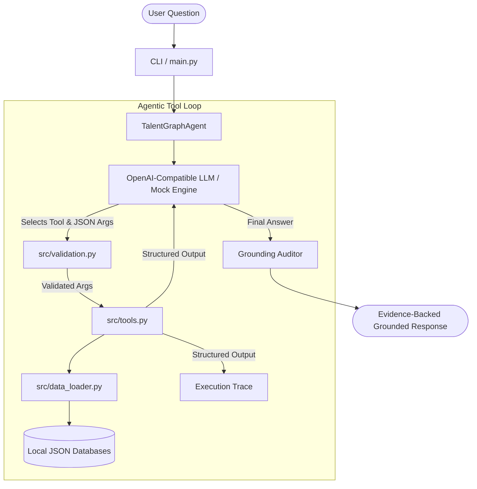

# TALENTGRAPH AGENT
> **Skill First Labs — AI/ML Internship Shortlisting Assignment**  
> *Milestone 2: An Explainable AI Career Intelligence Assistant*

TalentGraph Agent is a lightweight, reliable, and fully explainable AI assistant designed for academic talent management. Rather than relying on unbounded parametric memory, the agent utilizes native tool calling to retrieve verified student profiles, search internships, calculate deterministic skill overlap scores, and generate curated learning roadmaps.

---

## Table of Contents
1. [Problem Statement](#problem-statement)
2. [Architecture Overview](#architecture-overview)
3. [Native Tool Calling Workflow](#native-tool-calling-workflow)
4. [Dataset Schema](#dataset-schema)
5. [Tool Documentation](#tool-documentation)
6. [Grounding & Guardrail Strategy](#grounding--guardrail-strategy)
7. [Consistency Lab (Signature Differentiating Feature)](#consistency-lab)
8. [Setup & Quick Start](#setup--quick-start)
9. [Demonstration Queries](#demonstration-queries)
10. [Automated Testing](#automated-testing)
11. [Limitations & Honest Evaluation](#limitations--honest-evaluation)
12. [Future Improvements](#future-improvements)
13. [2-Minute Video Demonstration Script](#video-demonstration-script)

---

## Problem Statement

Standard generative LLMs suffer from three core failure modes when applied to talent management:
1. **Hallucination & Fabrication:** Inventing student credentials, courses, GPA, or internship requirements.
2. **Arithmetic & Scoring Inconsistency:** Performing unreliable probabilistic math when calculating candidate match percentages.
3. **Black-Box Recommendations:** Offering recommendations without citing underlying source records or explaining why a candidate fell short.

TalentGraph Agent solves these issues with a minimalist, production-ready architecture:
- **Zero Framework Bloat:** No LangChain, vector DBs, or complex abstractions. Standard Python 3.11+ and official OpenAI SDK.
- **Strict Evidence Grounding:** All claims cite local source record identifiers (`students.json / S001`, `internships.json / I002`).
- **Deterministic Logic:** Mathematical scores and skill comparisons are executed entirely in Python.
- **Repeatability Lab:** Systematic evaluation of factual consistency across repeated inferences at temperature zero.

---

## Architecture Overview



---

## Native Tool Calling Workflow

1. **User Query Input:** The user submits a question via CLI (e.g., *"How suitable is student S001 for internship I002?"*).
2. **Tool Selection:** The LLM receives the system prompt and OpenAPI tool schemas (`TOOL_DEFINITIONS`) and determines which tool(s) to invoke.
3. **Pre-Execution Argument Validation:** `src/validation.py` validates argument types, required keys, and non-empty strings before execution.
4. **Deterministic Python Execution:** `src/tools.py` accesses `src/data_loader.py`, resolves canonical skill aliases, computes set intersections, and executes formulas.
5. **Tool Result Feedback:** The tool returns a structured JSON payload to the LLM.
6. **Iterative Multi-Tool Support:** If further information is required (such as comparing all internships for candidate ranking), the agent invokes additional tools up to `MAX_TOOL_ITERATIONS`.
7. **Synthesis & Evidence Citation:** The LLM generates the final answer incorporating source record IDs and disclaimers.
8. **Grounding Audit:** An automated validation layer audits whether missing data was respected, whether scores match tool outputs, and whether source references exist.

---

## Dataset Schema

The local demonstration database consists of 3 curated JSON files in `data/`:

### 1. `data/students.json` (6 Fictional Profiles)
```json
{
  "student_id": "S001",
  "name": "Aarav Sharma",
  "education": {
    "degree": "Bachelor of Technology in Computer Science",
    "institution": "Delhi Technological University",
    "graduation_year": 2025
  },
  "skills": ["Python", "SQL", "Machine Learning", "Pandas", "Scikit-Learn"],
  "projects": [
    {
      "title": "Predictive Customer Churn Model",
      "description": "Built an end-to-end churn prediction pipeline using Random Forest and Pandas.",
      "technologies": ["Python", "Pandas", "Scikit-Learn"]
    }
  ]
}
```
*(Note: Student S001 intentionally omits the `gpa` field to verify missing-attribute guardrails).*

### 2. `data/internships.json` (6 Fictional Opportunities)
```json
{
  "internship_id": "I001",
  "role": "AI / Machine Learning Intern",
  "company": "Apex AI Labs",
  "required_skills": ["Python", "Machine Learning", "Scikit-Learn", "Docker"],
  "description": "Develop, validate, and containerize supervised ML models for predictive talent analytics."
}
```

### 3. `data/learning_topics.json` (Curated Learning Roadmaps)
Maps verified technical skills to concrete modular learning objectives (e.g., Docker, FastAPI, PostgreSQL, PyTorch, Kubernetes). Prevents LLMs from inventing fictitious courses or non-existent certifications.

---

## Tool Documentation

| Tool Name | Arguments | Output Schema | Purpose & Guardrail |
| :--- | :--- | :--- | :--- |
| `get_student_profile` | `student_id: str` | `status`, `student_id`, `name`, `skills`, `education`, `projects`, `source` | Returns verified student records. Returns structured `not_found` when student is missing; never invents fictional profiles. |
| `search_internships` | `skill: str` | `status`, `query_skill`, `matched_count`, `matched_internships`, `source` | Case-insensitive skill search with alias normalization. Returns structured `empty` if zero matches. |
| `calculate_skill_match` | `student_id: str`, `internship_id: str` | `status`, `match_percentage`, `matched_skills`, `missing_skills`, `explanation`, `source_record_ids`, `disclaimer` | Deterministic Python calculation: `(matched / total) * 100`. Guaranteed zero-division safe. Disclaims hiring predictions. |
| `get_skill_gap` | `student_id: str`, `internship_id: str` | `status`, `existing_relevant_skills`, `missing_required_skills`, `suggested_learning_topics`, `unmapped_missing_skills`, `sources` | Identifies missing skills and retrieves verified curriculum from `learning_topics.json`. Reports unmapped skills explicitly. |

---

## Grounding & Guardrail Strategy

1. **System Prompt Constraint:** Restricts factual statements strictly to tool payloads.
2. **Missing Entity Handling:** Unknown IDs (e.g. `S999`) return structured errors from tools and prompt clear missing-entity admissions.
3. **Missing Attribute Handling:** Unrecorded fields (e.g. S001's GPA) are reported as `"not stored in the database"`, preventing fabricated figures.
4. **Deterministic Math:** Percentages are computed exclusively in Python. The LLM is prohibited from mental arithmetic.
5. **Skill Alias Normalization:** Canonical dictionary resolves aliases (`"ML"` → `"Machine Learning"`, `"ReactJS"` → `"React"`, `"K8s"` → `"Kubernetes"`).
6. **Automated Audit Layer:** `src/validation.py` inspects every completed answer for source citations, percentage preservation, and missing-data compliance.

---

## Consistency Lab

The **Consistency Lab** (`evaluation/evaluate_consistency.py`) is the signature evaluation suite.

### Methodology
1. Loads 8 diverse test questions covering profile lookup, internship search, skill matching, comparative ranking, missing attributes, and unknown entities.
2. Executes each question **twice** with `temperature=0.0`.
3. Extracts **normalized structured facts** from both runs:
   - Student IDs & Internship IDs
   - Match percentages
   - Matched and missing skill sets
   - Missing-data flags (unknown entity, unrecorded GPA, empty results)
   - Sequence of tools invoked
4. Evaluates:
   - **Factual Agreement Rate:** Do the structured facts in Run 1 and Run 2 match 100%?
   - **Exact Text Match Rate:** Do the raw strings match character-for-character?
5. Exports reports to `reports/consistency_report.json` and a visual dashboard at `reports/consistency_report.html`.

> **Why Normalized Fact Comparison?**  
> While temperature zero sets greedy token selection, non-determinism can still occur in modern LLM APIs due to concurrent GPU floating-point operations, batching schedules, and token order ties. Fact extraction decouples semantic consistency from superficial phrasing variations.

---

## Setup & Quick Start

### 1. Prerequisites
- Python 3.11+
- pip

### 2. Install Dependencies
```bash
cd milestone-2-talentgraph-agent
pip install -r requirements.txt
```

### 3. Configure Environment (Optional for Live API)
Copy `.env.example` to `.env`:
```bash
cp .env.example .env
```
Add your OpenAI or compatible API key.  
*(Note: If no API key is configured, TalentGraph Agent automatically operates in **Deterministic Mock Engine** mode, running the complete tool-calling loop hermetically).*

### 4. Interactive CLI
```bash
python main.py
```

### 5. Run Canonical Demo Suite
```bash
python main.py --demo
```

### 6. Run Consistency Lab
```bash
python evaluation/evaluate_consistency.py
```
View the interactive report: `reports/consistency_report.html`.

---

## Demonstration Queries

| # | Question | Tool Invoked | Grounded Output Summary |
| :- | :--- | :--- | :--- |
| 1 | *What skills does student S001 have?* | `get_student_profile` | Python, SQL, Machine Learning, Pandas, Scikit-Learn (`students.json / S001`) |
| 2 | *Find internships requiring Python.* | `search_internships` | Found 4 internships (I001, I002, I003, I004) with role and company details |
| 3 | *How suitable is student S001 for internship I002?* | `calculate_skill_match` | Overlap: **75.0%** (Matched: Python, SQL, Pandas; Missing: Data Visualization) |
| 4 | *Which required skills are missing for S001 for I001?* | `calculate_skill_match` | Missing: **Docker** (Matched: Python, ML, Scikit-Learn) |
| 5 | *Which internship has highest skill-overlap for S001?* | `calculate_skill_match` (x6) | Ranked across all 6 postings; **I001** and **I002** tied at **75.0%** |
| 6 | *What is GPA of S001 if GPA is not stored?* | `get_student_profile` | Explicitly states GPA is **not stored in the database** |
| 7 | *What do you know about student S999?* | `get_student_profile` | Returns explicit **not found** in local records |
| 8 | *Recommend learning topics for S001's missing skills for I001.* | `get_skill_gap` | Returns curated topics for **Docker** from `learning_topics.json` |

---

## Automated Testing

Run the 32 comprehensive automated tests:
```bash
python -m pytest -v
```

### Test Coverage Highlights
- `tests/test_tools.py`: Retrieval, case insensitivity, unknown IDs, alias normalization, zero required skills division safety, unmapped skill reporting.
- `tests/test_validation.py`: Argument schema constraints, grounding auditor, missing-data compliance, score integrity.
- `tests/test_agent.py`: Single & multi-tool query execution, GPA absence compliance, API error handling, repeated query consistency.

---

## Limitations & Honest Evaluation

1. **Syntactic Skill Overlap:** The match percentage calculates direct required-skill overlap. It does not model skill proficiency levels, course grades, or interview readiness.
2. **Local Schema Scope:** The dataset contains 6 students and 6 internships. In production, a relational database or vector store with hybrid lexical-semantic filtering would be required.
3. **LLM Non-Determinism:** Even with `temperature=0.0`, floating-point concurrency and token ties in commercial LLMs can introduce phrasing variations.
4. **Learning Roadmap Static Depth:** The learning roadmap is currently derived from a curated local catalog and does not dynamic adapt to a candidate's prerequisite knowledge.

---

## Future Improvements

1. **Multi-Factor Scoring:** Incorporate project relevance and coursework depth alongside boolean skill matching.
2. **Dynamic Skill Ontologies:** Connect with open job skill taxonomies (e.g., O*NET, ESCO) for automated alias resolution.
3. **Structured Student Profile Upload:** Allow students to ingest JSON or Markdown resumes with automated schema validation.
4. **Interactive Skill Gap Planner:** Generate interactive multi-week study schedules with benchmark assignments.

---

## Video Demonstration Script

See [`DEMO_SCRIPT.md`](DEMO_SCRIPT.md) for the complete 2-minute video recording walkthrough.
